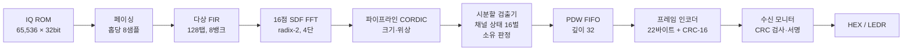

# rtl-channelizer

**16채널 다상 필터뱅크(PFB) 채널라이저 + 채널별 PDW 생성기 (순수 RTL, Cyclone V)**

광대역 IQ 입력을 16개 주파수 채널로 나누고, 채널마다 펄스를 검출해 PDW(Pulse Descriptor Word)를 만든 뒤 CRC-16이 붙은 22바이트 텔레메트리 프레임으로 내보내는 회로입니다. 다상 FIR, 16점 스트리밍 FFT, 파이프라인 CORDIC, 시분할 검출기를 IP 코어 없이 Verilog로 작성했고, DE10-Standard 보드에서 동작을 확인했습니다. 앞선 프로젝트 [rtl-pdw](https://github.com/jeongyoonwoo/rtl-pdw)의 단일 채널 검출기 앞단에 채널라이저를 붙인 것입니다.

| 항목 | 결과 |
|---|---|
| 채널화 | 16채널, 간격 500 kHz, 2배 오버샘플링 |
| 채널 응답 | 통과대역 리플 0.073 dB, 1채널 떨어진 톤 −41.7 dB, 1.5채널 이상 −81.3 dB |
| 검출 | 시나리오 5개, 정답 910개 중 910개 검출, 오검출·중복 0 |
| RTL 검증 | FIR·FFT·채널 출력·CORDIC·PDW·프레임 모두 비트 단위 Python 모델과 차이 0 |
| 테스트벤치 검증 | 일부러 넣은 오류 32종 중 31종 검출 (1종은 결과가 같은 등가 변이) |
| 처리량 | 홉당 16클록(입력 25 MSPS 상당)에서도 같은 PDW 스트림 |
| 자원 | ALM 4,028 / 41,910 (9.6%), M10K 270, DSP 18 |
| 타이밍 | Fmax 74.28 MHz (동작 클록 50 MHz), Critical Warning 0 |
| 보드 | HEX 표시값·스트림 서명이 시뮬레이션과 일치, Signal Tap으로 첫 프레임 22바이트 확인 |

단일 채널 검출기는 같은 시각에 들어온 두 펄스를 구분하지 못하고, 대역 전체의 잡음을 그대로 받습니다. ES(전자전 지원) 수신기가 앞단에서 대역을 채널로 나누는 이유가 이 두 가지입니다. 이 프로젝트는 채널화가 실제로 두 문제를 푸는지 시험했습니다. 서로 다른 채널의 동시 펄스가 각각 PDW로 나오는지, 그리고 잡음이 4배인 입력에서 오검출이 줄어드는지입니다.

---

## 1. 구조



입력 8샘플이 들어올 때마다(홉) 다상 FIR이 16갈래 값을 만들고, FFT가 이를 16개 채널 샘플로 바꿉니다. 채널 샘플은 한 클록에 하나씩 나오므로, CORDIC 하나와 검출기 하나가 16채널을 차례로 처리합니다. 검출기는 채널마다 상태를 따로 보관하고, 펄스가 끝나면 그 채널이 펄스를 "소유"하는지 판정한 뒤 PDW를 FIFO에 넣습니다. 프레임 인코더는 FIFO에서 PDW를 하나씩 꺼내 valid/ready 바이트 스트림으로 내보냅니다.

채널 k의 출력은 다음 정의식과 같습니다. RTL의 다상 FIR + FFT 분해가 이 식과 같은 값을 내는지는 Python에서 먼저 확인했습니다(상대 오차 2.1 × 10⁻¹⁴).

```math
y_k[m] = (-1)^{km} \sum_{n=0}^{127} h[n]\, x[8m+7-n]\, e^{\,j 2\pi k n / 16}
```

### 주요 설계 값

| 항목 | 값 |
|---|---|
| 클록 / 입력 / 채널 출력 | 50 MHz / 8 MSPS / 채널당 1 MSPS (홉당 50클록, 논리 단위) |
| 프로토타입 필터 | 128탭(갈래당 8탭), Kaiser β = 8, −6 dB 점 0.75채널 |
| 고정소수점 | 입력 Q1.15, 계수 18비트, FIR·FFT 18비트(Q3.15), FFT 단마다 1/2, 출력 16비트 포화 |
| FFT | radix-2 SDF, DIF 4단, 20비트 버터플라이, 비트 반전 순서 출력 |
| CORDIC | Vectoring 모드, 18단 파이프라인, 클록당 1샘플 |
| 검출 문턱 | TH_HI 3,000, TH_LO 2,000 LSB, 종료 유예 2샘플, 최소 폭 4샘플 (rtl-pdw와 같음) |
| 주파수 측정 | 시작 3샘플을 건너뛰고 위상차 8개 평균, 끝 4샘플(FREQ_GUARD)을 피하므로 측정 PW ≥ 15에서 유효 |

### 클록 예산 (홉당 50클록)

| 블록 | 홉당 사용 클록 | 곱셈기 |
|---|---|---|
| 다상 FIR | 16 (클록당 1갈래) | 16 |
| 16점 FFT | 16 (클록당 1샘플) | 8 |
| 파이프라인 CORDIC | 16 | 0 |
| 시분할 검출기 | 16 | 0 |

가장 바쁜 블록이 홉당 16클록이므로, 홉 간격을 16클록까지 줄여도(입력 25 MSPS 상당) 같은 결과가 나와야 합니다. 이를 시뮬레이션과 보드 양쪽에서 확인했습니다.

### PDW 필드

| 필드 | 폭 | 내용 |
|---|---|---|
| CH | 8비트 | 채널 번호, 부호 있음 (−8 ~ +7) |
| TOA | 32비트 | 처음 TH_HI를 넘은 채널 샘플 번호 (1샘플 = 1 µs, 필터 군지연 7샘플 포함) |
| PW | 16비트 | 마지막 TH_LO 이상 샘플 − TOA + 1 |
| PA | 16비트 | 주파수가 유효하면 측정 창 8샘플의 크기 평균, 아니면 피크 |
| FREQ | 16비트 | 채널 안 주파수 (Q1.15, 500 kHz = 32,768) |
| FLAGS | 16비트 | bit0 주파수 유효, bit1 크기 포화 |

절대 주파수 = CH × 500 kHz + FREQ × 500 kHz / 32,768 입니다. CH −8은 대역 양 끝(±4 MHz)이 겹치는 채널이라 −4.25 ~ −3.75 MHz로 표기합니다.

### 프레임 형식 (22바이트)

| ASM | FRAME_CNT | N_PDW | CH | TOA | PW | PA | FREQ | FLAGS | CRC |
|---|---|---|---|---|---|---|---|---|---|
| 4 | 2 | 1 | 1 | 4 | 2 | 2 | 2 | 2 | 2 |

ASM은 0x1ACFFC1D이고, CRC-16-CCITT(0x1021)는 FRAME_CNT부터 FLAGS까지 계산합니다. rtl-pdw의 21바이트 프레임에 CH 1바이트를 더했습니다.

---

## 2. 설계 결정

### 임계 샘플링 대신 2배 오버샘플링

채널 간격과 채널 출력률이 같은 임계 샘플링은 자원이 가장 적지만, 채널 경계 근처 신호가 이웃 채널에서 **주파수가 접힌 채로** 잡힙니다. 같은 검출기를 두 방식에 붙여 Python 모델로 비교했습니다(ch3 중심에서 톤을 옮김).

| 톤 위치 (채널) | 임계 ch3 | 임계 ch4 | 2배 ch3 | 2배 ch4 |
|---|---|---|---|---|
| +0.30 | 0 dB, +300 kHz | −76 dB | 0 dB, +150 kHz | −3.5 dB, −350 kHz |
| +0.45 | −1.6 dB, +450 kHz | −15 dB, **주파수 틀림** | 0 dB, +225 kHz | −0.3 dB, −275 kHz |
| +0.55 | −15 dB, **주파수 틀림** | −1.6 dB, −450 kHz | −0.3 dB, +275 kHz | 0 dB, −225 kHz |

임계 샘플링에서는 입력 진폭 0.32 이상이면 −15 dB 성분이 문턱을 넘어, 틀린 주파수의 유령 PDW가 생깁니다. 2배 오버샘플링에서는 펄스 하나가 이웃 2~3채널에서 함께 잡히지만, **모든 채널에서 주파수가 정확**합니다. 그래서 측정 주파수가 자기 채널 범위(±250 kHz) 안인 채널만 보고하면 중복을 없앨 수 있습니다. 대가는 대역 대비 잡음 억압이 약 1.6 dB 작다는 것입니다(−10.7 dB vs −12.3 dB). 임계 샘플링은 RTL로 만들지 않고 이 비교로 선택 근거만 남겼습니다.

### 중복 제거: 채널 소유 판정

| 펄스 | 판정 규칙 | 이유 |
|---|---|---|
| 측정 PW ≥ 15 (주파수 유효) | FREQ ∈ [−250 kHz, +250 kHz)이면 보고 | 정상 구간에서 잰 주파수는 이웃 채널에서도 정확하므로 채널 안에서 판정이 끝남 |
| 짧은 펄스 (주파수 무효) | 펄스 동안 자기 채널 크기가 양옆 채널보다 크면 보고 (dl > 0, dr ≥ 0) | 짧은 펄스는 가장자리 위상이 경계 쪽으로 끌려(270 kHz가 약 240 kHz로 측정됨) 주파수로 판정할 수 없음 |

진폭 비교를 위해 CORDIC 크기 출력을 홉 단위로 모으는 이웃 크기 이중 버퍼를 두었습니다. 검출기는 채널 k를 처리할 때 k−1, k, k+1의 크기를 함께 읽습니다. 보고하지 않은 펄스는 `not_owned_cnt`로 셉니다(S1에서 206개).

### 시분할 검출

FFT는 채널 샘플을 한 클록에 하나씩 내보냅니다. 이 순서를 그대로 받아 CORDIC 1개와 검출기 1개로 16채널을 처리하고, 채널마다 상태(약 190비트)를 레지스터 파일에 보관합니다. 같은 채널은 16클록 이상 간격으로 돌아오므로, 상태 읽기-계산-쓰기를 한 클록에 끝내도 해저드가 없습니다. 검출기 16벌을 병렬로 두는 방식보다 자원이 작고, 원본 `pdw_detector` 16개를 테스트벤치의 독립 기준으로 쓸 수 있습니다.

### 설계 중에 바꾼 것

Python 모델 단계에서 정답표와 비교하며 다음을 바꿨습니다. 판정 기준을 먼저 정해 두었기 때문에, 기준을 넘는 결과가 나오면 원인을 찾아 설계를 고쳤습니다.

| 바꾼 것 | 이유 |
|---|---|
| FIR 출력 Q2.16 → Q3.15 | 갈래별 계수 절댓값 합이 최대 2.023이라 Q2.16은 최악 입력에서 넘칠 수 있음 |
| FREQ_GUARD 4 추가 | 측정 창이 필터의 뒤쪽 링잉에 닿아 PA 최대 1,350 LSB, FREQ 최대 8 kHz 오차가 남 |
| 짧은 펄스 소유: 주파수 → 이웃 진폭 우세 | 가장자리 위상이 끌려 두 채널이 모두 소유함 |
| 동시 신호 분리 기준 1.5 → 2채널 | 1.5채널 간격에서 가운데 채널이 두 신호를 섞어 유령을 만듦 |
| S1 입력 진폭 합 1.45 → 0.95 | 입력 포화의 상호변조가 모든 채널로 퍼져 유령을 만듦 (시나리오 설계 오류) |

---

## 3. 검증 방법

검증은 네 층으로 나눴고, 판정 기준은 결과를 보기 전에 계획서에 고정했습니다.

1. **분해 ↔ 정의식**: 다상 FIR + FFT(부동소수점)가 위 정의식과 같은지 (상대 오차 2.1 × 10⁻¹⁴, 기준 10⁻⁹)
2. **비트 모델 ↔ 부동소수점 모델**: 고정소수점 오차 RMS 0.65 LSB, 채널 잡음보다 20 dB 낮은 기준 3.8 LSB 안
3. **RTL ↔ 비트 모델**: 블록마다 단독 테스트벤치를 만들고, 마지막에 최상위 출력 바이트까지 비트 단위로 비교 (모두 차이 0)
4. **모델 ↔ 정답표**: 신호를 만들 때 함께 생성한 정답표로 검출률과 필드 오차 판정

최상위 테스트벤치(`tb_chz_top.v`)는 출력 바이트 스트림만 보고 프레임을 해독해 CRC와 정답표를 검사합니다. 역압(ready 상시 1, 약 50%, 약 1/8)과 홉 간격 50·16클록 조합에서 스트림이 같은지도 확인했습니다.

### 테스트벤치가 오류를 잡는지 확인 (오류 주입)

단계마다 RTL이나 기대값을 일부러 틀려 보고, 테스트벤치가 FAIL을 내는지 확인했습니다. 잡지 못한 경우는 시험을 추가해 다시 확인했습니다.

| 단계 | 주입 / 검출 | 처음에 못 잡아서 추가한 시험 |
|---|---|---|
| 2 다상 FIR | 5 / 5 | 반올림 동점: 합의 하위 16비트가 정확히 0x8000일 때만 달라지는 오류 → −32768 임펄스 입력 |
| 3 FFT | 7 / 7 | — |
| 4 채널라이저 | 6 / 6 | 출력 16비트 포화 → 진폭 0.97 펄스로 포화를 일부러 만드는 시험 |
| 5 CORDIC·검출 | 8 / 7 + 등가 1 | 판정 여유가 작은 경우 → 진폭 동점, 경계 주파수 ±16,384, 홉마다 바뀌는 이웃 단위 시험 |
| 6 FIFO·프레임 | 6 / 6 | FIFO가 거의 비어 있어 점유 오류가 안 보임 → 8채널 동시 종료 시나리오 S5, 프레임 중간 valid 유지 검사 |

등가 변이 1종은 코드를 바꿔도 모든 입력에서 출력이 같아지는 경우라 검출 대상이 아닙니다.

FFT 단계에서는 실제 버그도 찾았습니다. 버터플라이 차를 19비트로 계산해 최대 진폭 입력에서 넘쳤고, 최대 진폭 난수 시험이 이를 잡았습니다. 20비트로 넓히는 수정에서 생긴 부호 확장 실수도 같은 시험에서 잡혔습니다.

### 시나리오 (각 65,536샘플)

| 시나리오 | 구성 | 확인 목적 |
|---|---|---|
| S1 동시 방출원 | 방출원 4개, 서로 3채널 이상 떨어짐, 같은 시각 펄스가 자주 겹침 | 동시 펄스가 채널별 PDW로 각각 나오는지 |
| S2 소유·경계 | 채널 안 오프셋 0 ~ ±260 kHz, ±4 MHz 채널, 짧은 펄스, 2채널 간격 동시 신호 | 중복 제거, 소유 판정, 분리 한계 |
| S3 경계 조건 | PW 4·3, 문턱 근처 진폭, 포화, 1샘플 드롭 | 문턱·최소 폭·유예·포화 동작 |
| S4 잡음 | 입력 잡음 σ 0.016 (rtl-pdw의 4배), 약한 펄스 진폭 0.08 | 채널화 잡음 이득 |
| S5 동시 종료 | 8채널 펄스가 같은 시각에 끝남 | FIFO와 프레임 중재 |
| T1 톤 스윕 | 톤을 1/32채널 간격으로 3채널에 걸쳐 이동 | 채널 응답 |

---

## 4. 결과

### 채널 응답 (T1, RTL 테스트벤치가 직접 측정)

| 채널 중심에서 거리 (채널) | 0 | 0.25 | 0.5 | 0.625 | 0.75 | 0.875 | 1.0 | 1.125 | 1.25 | ≥ 1.5 |
|---|---|---|---|---|---|---|---|---|---|---|
| 응답 (dB, 최악값) | 0.00 | 0.00 | −0.07 | −1.25 | −6.02 | −17.4 | −41.7 | −82.3 | −80.0 | −81.3 |

판정 기준은 통과대역(±0.5채널) 리플 ≤ 0.2 dB, 1채널 ≤ −40 dB, 1.5채널 이상 ≤ −80 dB였습니다. 어떤 주파수든 가장 가까운 채널 중심에서 0.5채널 안에 있으므로, 모든 신호를 적어도 한 채널에서 0.07 dB 안으로 평평하게 받습니다.

### 정확도 (정답표 대비)

| 필드 | S1 | S2 | S3 | S4 | S5 | 기준 |
|---|---|---|---|---|---|---|
| 검출 / 정답 | 204 / 204 | 42 / 42 | 9 / 9 | 31 / 31 | 624 / 624 | 100% |
| 오검출·중복 | 0 | 0 | 0 | 0 | 0 | 0 |
| TOA 오차 (샘플) | 0 | 0 | 0 ~ +1 | +1 | 0 ~ +1 | −1 ~ +2 (S4 +3) |
| PW 오차 (샘플) | +1 | +1 ~ +3 | −1 ~ +1 | −1 ~ 0 | 0 ~ +1 | −2 ~ +3 (S4 ±3) |
| FREQ 최대 오차 (kHz) | 1.13 | 1.42 | 0.86 | 3.48 | 1.53 | ±3 (S4 ±6) |
| PA 최대 오차, 창 평균 (LSB) | 121 | 99 | 70 | 259 | 109 | 3% + 230 (S4 3% + 400) |
| PA 최대 오차, 피크 (LSB) | 1,001 | 2,300 | 564 | — | — | 8% + 650 |
| FIFO 최대 점유 | 1 | 1 | 1 | 1 | 7~8 | 넘침 0 |
| 스트림 서명 | 0x3356 | 0xFE8A | 0x41C7 | 0x0ADC | 0x9491 | 모델과 같음 |

S4 기준은 잡음 크기에서 유도해 따로 정했습니다. S3에서는 PW 3샘플 글리치 1건을 의도대로 거부했습니다. 모든 시나리오에서 CRC 통과 100%, FIFO 넘침 0, 내부 오버플로 0입니다.

### 잡음 이득 (S4)

| 방식 | 검출 / 정답 | 오검출 |
|---|---|---|
| 채널화 후 검출 (이 설계) | 31 / 31 | 0 |
| 같은 검출기를 8 MSPS 광대역 입력에 직접 적용 (Python 대조군) | 31 / 31 | 5 |

채널당 잡음 전력은 10.67 dB 줄었습니다(16채널 평균, 기준 10.7 ± 0.5 dB). RTL 테스트벤치로 잰 값은 10.66 dB입니다.

### 동시 신호 분리 한계 (Python 모델, 위치 7곳 × 2신호)

| 간격 (채널) | 긴 펄스, 같은 진폭 | 짧은 펄스, 같은 진폭 | 긴 펄스, 다른 진폭 | 짧은 펄스, 다른 진폭 |
|---|---|---|---|---|
| 1.0 | 14 / 14 | 7 / 14 | 13 / 14 | 7 / 14 |
| 1.5 | 14 / 14 | 12 / 14, 유령 1 | 14 / 14, 유령 1 | 7 / 14 |
| 2.0 | 14 / 14 | 14 / 14 | 14 / 14 | 12 / 14 |
| 2.25 | 14 / 14 | 14 / 14 | 14 / 14 | 14 / 14 |

긴 펄스는 2채널(1 MHz), 진폭이 다른 짧은 펄스는 2.25채널 이상 떨어져야 누락·유령이 없습니다. 이 값을 설계 사양의 분리 간격으로 정했습니다.

### 합성·타이밍 (Quartus, 5CSXFC6D6F31C6)

| 항목 | 값 |
|---|---|
| ALM | 4,028 / 41,910 (9.6%) |
| 레지스터 | 6,062 |
| 블록 메모리 | 2,108,546비트 (37%), M10K 270 / 553 (입력 ROM 65,536 × 32가 256개) |
| DSP 블록 | 18 / 112 |
| Fmax (Slow 1100mV 85°C) | 74.28 MHz |
| 최악 slack (다중 코너) | setup +6.537 ns, hold +0.106 ns, recovery +13.299 ns, removal +1.866 ns |
| Critical Warning / unconstrained 경로 | 0 / 0 |

공식 수치는 Signal Tap을 뺀 회로 기준입니다. Signal Tap을 넣은 빌드에서는 JTAG 포트 3개(입력 2, 출력 1)가 unconstrained로 보고되지만, 디버그 회로라 설계와는 무관합니다.

---

## 5. 보드 데모 (DE10-Standard)

S1 시나리오를 한 번 재생하면 HEX에 정상 프레임 수와 스트림 서명이 표시됩니다. SW[3]으로 홉 간격을 50클록(데모)과 16클록(최대 처리량)으로 바꿀 수 있습니다.

| SW[2:1] | 표시 | 데모 속도 | 빠른 모드 | 의미 |
|---|---|---|---|---|
| 00 | 프레임 수, 서명 | `CC 3356` | `CC 3356` | 정상 프레임 204개(0xCC), 스트림 서명 0x3356 |
| 01 | FIFO 넘침, 오류 프레임 | `00 0000` | `00 0000` | 넘침 0, 오류 0 |
| 10 | FIFO 최대 점유, 비소유 | `01 00CE` | `01 00CE` | 최대 점유 1, 소유하지 않아 버린 펄스 206개 |
| 11 | 글리치 | `00 00d2` | `00 00d2` | 최소 폭 미달로 버린 후보 210개 |

두 속도 모두 LEDR[0] 끝, LEDR[4] 합격이 켜지고 LEDR[1]·[2]·[3]·[5](오버런·FIFO 넘침·오류 프레임·출력 포화)는 꺼졌습니다. 빠른 모드에서는 LEDR[6]이 함께 켜집니다. 보드 최상위 테스트벤치(`tb_de10_chz_top.v`)에서 빠른 모드는 3.12배 빨리 끝났고(8,193 µs → 2,622 µs) 표시값은 같았습니다. 다른 시나리오의 00 표시 기대값은 S2 `2A FE8A`, S3 `09 41C7`, S4 `1F 0ADC`, S5 `70 9491`입니다.

스트림 서명은 출력된 4,488바이트(204프레임 × 22바이트) 전체에 대한 CRC-16입니다. 서명이 시뮬레이션과 같다는 것은 보드에서 나간 바이트 전체가 시뮬레이션과 비트 단위로 같다는 뜻입니다.

### Signal Tap 캡처

샘플 클록 CLOCK_50, 깊이 256, `m_valid` 상승 에지 트리거로 첫 프레임을 잡았고 기대값과 같았습니다.

```
idx      0  1  2  3 | 4  5 | 6 | 7 | 8  9 10 11 | 12 13 | 14 15 | 16 17 | 18 19 | 20 21
m_data  1A CF FC 1D | 00 00 | 01| FA| 00 00 00 CF| 00 0D | 41 CB | 00 00 | 00 00 | 26 99
         ASM          FRAME  N   CH  TOA          PW      PA      FREQ    FLAGS   CRC
m_valid ‾‾‾‾‾‾‾‾‾‾‾‾‾‾‾‾‾‾‾‾‾‾‾‾‾‾‾‾‾‾‾‾‾‾‾‾‾‾‾‾‾‾‾‾‾‾‾‾‾‾‾‾‾‾‾‾‾‾‾‾‾‾‾‾‾‾‾‾‾‾‾‾
m_last  _____________________________________________________________________‾‾
```

CH 0xFA는 −6(−3 MHz 채널), TOA 207, PW 13, PA 16,843입니다. 이 펄스는 측정 PW가 15 미만이라 FREQ가 무효(0, FLAGS bit0 = 0)로 나옵니다. 아래 한계에 적은 "주파수 측정에는 PW 약 14 µs 이상 필요"가 첫 프레임에서 그대로 보입니다.

보드 작업은 외부 반출이 제한된 환경에서 했기 때문에, 보드 사진과 Signal Tap 화면 대신 관측값을 텍스트로 기록했습니다.

---

## 6. 파일 구성

```
rtl-channelizer/
├── rtl/
│   ├── pfb_fir.v            다상 FIR (8뱅크 순환 버퍼, 클록당 1갈래, 지연 3클록)
│   ├── fft16_sdf.v          16점 radix-2 SDF FFT (DIF 4단, 유효 게이팅, 단마다 1/2)
│   ├── channelizer.v        ROM 재생(홉 페이싱, 비우기 홉) + FIR + FFT + 16비트 포화
│   ├── cordic_pipe.v        파이프라인 CORDIC (Vectoring, 18단, 채널 태그 동반)
│   ├── pdw_detector_tdm.v   시분할 검출기 (이웃 크기 이중 버퍼, 채널 상태 16벌, 소유 판정)
│   ├── chz_detect.v         cordic_pipe + pdw_detector_tdm
│   ├── pdw_fifo.v           PDW FIFO (깊이 32, 넘침 수·최대 점유 기록)
│   ├── chz_framer.v         22바이트 프레임 (CH 필드, CRC-16, valid/ready/last)
│   ├── chz_top.v            최상위: 채널라이저 → 검출 → FIFO → 프레임
│   ├── chz_stream_mon.v     보드용 수신 모니터 (CRC 검사, 스트림 서명)
│   ├── de10_chz_top.v       보드 최상위 (SCEN, 속도·표시 선택, HEX·LED)
│   ├── cordic_engine.v      이전 프로젝트의 CORDIC (cordic_pipe 검증 기준, 합성 제외)
│   └── pdw_detector.v       rtl-pdw 검출기 + FREQ_GUARD (시분할 검출기 검증 기준, 합성 제외)
├── tb/
│   ├── tb_pfb_fir.v         FIR 출력 vs 비트 모델 (S1, 최대 진폭 난수, 반올림 동점 임펄스)
│   ├── tb_fft16.v           FFT 출력 vs 비트 모델 (S1, 난수·포화, 단일 톤 / 연속·끊김 입력)
│   ├── tb_channelizer.v     채널 출력 vs 비트 모델 + 응답·잡음 측정 + 출력 포화
│   ├── tb_cordic_pipe.v     cordic_pipe vs cordic_engine (극단값 + 난수)
│   ├── tb_pdw_tdm.v         시분할 검출기 단위 시험 (판정 여유가 작은 입력)
│   ├── tb_chz_detect.v      통합 검출: 모델 PDW + 원본 pdw_detector 16개와 비교
│   ├── tb_chz_top.v         최상위: 바이트 스트림 해독, 모델 프레임, 정답표 정확도, 역압
│   └── tb_de10_chz_top.v    보드 최상위: HEX·LED 표시값, 두 속도에서 같은지
├── scripts/
│   ├── chz_model.py         부동소수점·비트 단위 참조 모델 (FIR, FFT, CORDIC, 검출·소유 판정, 프레임)
│   ├── gen_channelizer.py   시나리오, 정답표, 모델 출력, 1단계 판정 (report_stage1.txt)
│   ├── analyze_channelizer.py  분해 검증, 고정소수점 오차, 잡음, 임계 vs 2배, 분리 간격 (report_analysis.txt)
│   └── gen_fir_ref.py, gen_fft_ref.py, gen_ch_ref.py, gen_tdm_ref.py  블록별 시험 입력과 기대값
├── sim_data/                스크립트가 만든 파일 (시드 고정, 재현 가능)
├── sim/run_stage2~7.do      ModelSim 단계별 일괄 실행
├── quartus/
│   ├── de10_chz_top.sdc     50 MHz 클록 제약, 입출력 false path
│   └── create_project.tcl   Quartus 프로젝트 생성 (선택)
└── .gitignore               Quartus·ModelSim 생성물 제외
```

## 7. 실행 방법

모든 명령은 **저장소 루트에서** 실행합니다. RTL과 테스트벤치가 `sim_data/...` 상대 경로로 파일을 읽기 때문입니다.

**데이터 다시 만들기 (선택)**: `sim_data/`가 이미 들어 있으므로 필요하지 않습니다. Python 3와 NumPy로 아래를 실행하면 같은 파일이 나옵니다.

```
python scripts/gen_channelizer.py sim_data
python scripts/analyze_channelizer.py sim_data
python scripts/gen_fir_ref.py sim_data
python scripts/gen_fft_ref.py sim_data
python scripts/gen_ch_ref.py sim_data
python scripts/gen_tdm_ref.py sim_data
```

**시뮬레이션 (ModelSim)**: 단계별 스크립트가 컴파일부터 모든 조합 실행까지 합니다. 콘솔 마지막 줄에 PASS/FAIL이 나옵니다.

| 스크립트 | 내용 | 대표 단일 실행 |
|---|---|---|
| `do sim/run_stage2.do` | 다상 FIR, 5조합 | `vsim -onfinish stop -gTEST=0 work.tb_pfb_fir` |
| `do sim/run_stage3.do` | FFT, 7조합 | `vsim -onfinish stop -gTEST=1 work.tb_fft16` |
| `do sim/run_stage4.do` | 채널라이저, 응답·잡음·포화 포함 8조합 | `vsim -onfinish stop -gTEST=4 work.tb_channelizer` |
| `do sim/run_stage5.do` | CORDIC, 검출기 단위 시험, 통합 검출 | `vsim -onfinish stop -gTEST=0 work.tb_chz_detect` |
| `do sim/run_stage6.do` | 최상위, 시나리오·속도·역압 6조합 | `vsim -onfinish stop -gTEST=0 work.tb_chz_top` |
| `do sim/run_stage7.do` | 보드 최상위, S1·S5 | `vsim -onfinish stop -gSCEN=1 work.tb_de10_chz_top` |

단일 실행은 해당 스크립트 앞부분의 `vlog` 줄로 먼저 컴파일한 뒤 `run -all`을 입력합니다. 6·7단계는 시험 하나에 수 분이 걸립니다.

**보드 (Quartus)**: Quartus 프로젝트를 **저장소 루트에** 만듭니다. Quartus는 `$readmemh` 경로를 프로젝트 폴더 기준으로 찾으므로, 다른 폴더에 두면 ROM이 비어서 합성됩니다.

1. `quartus_sh -t quartus/create_project.tcl`을 실행하거나 New Project Wizard를 씁니다. 최상위는 `de10_chz_top`, 장치는 5CSXFC6D6F31C6입니다. `rtl/`에서 `cordic_engine.v`, `pdw_detector.v`를 뺀 11개와 `quartus/de10_chz_top.sdc`를 넣습니다.
2. 핀은 DE10-Standard 기본 qsf의 CLOCK_50, KEY, SW, LEDR, HEX0~5 배정을 붙여 넣습니다. 다른 프로젝트의 qsf에서 복사할 때 `SDC_FILE` 줄이 딸려 오지 않게 합니다. 딸려 오면 Critical Warning 332012가 나고 타이밍 수치가 무의미해집니다.
3. 조작: KEY[0] 리셋, SW[0] 재생, SW[3] 속도(0 = 홉당 50클록, 1 = 16클록), SW[2:1] 표시 선택. 시나리오는 `de10_chz_top.v`의 `SCEN` 파라미터(1~5, 기본 1)로 바꿉니다.

---

## 8. 한계와 다음 단계

이 설계는 동작 원리를 보이기 위한 시연용이며, 실제 ES 수신기와는 다음 차이가 있습니다.

- **처리 속도**: 클록당 1갈래 구조라 입력은 클록의 절반(50 MHz에서 25 MSPS, Fmax 기준 약 37 MSPS)이 상한입니다. 수백 MSPS를 받으려면 클록당 여러 샘플을 처리하는 병렬 FIR·FFT가 필요합니다.
- **분리 간격**: 동시 신호는 긴 펄스면 2채널(1 MHz), 진폭이 다른 짧은 펄스면 2.25채널 이상 떨어져야 합니다. 한 채널 안에서 겹치는 두 신호는 분리하지 않습니다.
- **주파수 측정 최소 PW**: 필터 가장자리 링잉을 피하느라 측정 PW 15 이상(실제 PW 약 14 µs 이상)에서만 FREQ가 유효합니다. 짧은 펄스는 채널 단위(500 kHz) 주파수만 알 수 있습니다.
- **소유 경계**: 채널 경계(±250 kHz)에서 ±3 kHz 안의 긴 펄스는 측정 잡음 때문에 중복되거나 누락될 수 있습니다. 시나리오는 이 띠를 피해 배치했습니다.
- **입력 포화**: 입력 진폭 합이 1을 넘으면 I/Q 포화의 상호변조가 모든 채널로 퍼져 유령 PDW가 생깁니다. 시나리오는 진폭 합을 0.95 이하로 두었습니다. 실제 수신기에서는 AGC가 맡을 부분입니다.
- **피크 PA**: 짧은 펄스의 PA(피크)는 필터 가장자리 오버슈트로 최대 약 10% 크게 나옵니다.
- **TOA**: 분해도는 1채널 샘플(1 µs)이고, 필터 군지연 7샘플은 정답표 쪽에서 보정했습니다. 보간과 적응 문턱(CFAR)은 다루지 않았습니다.
- **입력**: 합성 신호를 ROM에서 재생합니다. 실제 RF·ADC 연결과 끊김 없는 실시간 입력은 다루지 않았습니다.
- **프레임**: CCSDS 동기 마커와 CRC를 참고한 단순 구조이며, CCSDS 규격 전체를 따르지는 않습니다.

다음 단계로는 클록당 여러 샘플을 처리하는 병렬 구조로 처리 속도를 올리는 것, 그리고 이전 모노펄스 프로젝트와 연결해 PDW에 도래각(DOA)을 더하는 것을 생각하고 있습니다.

## 관련 프로젝트

순수 RTL CORDIC 모노펄스 수신기 → TMR 적용 및 SEU 오류 주입 검증 → [rtl-pdw](https://github.com/jeongyoonwoo/rtl-pdw) (단일 채널 PDW 생성기) → **rtl-channelizer**
